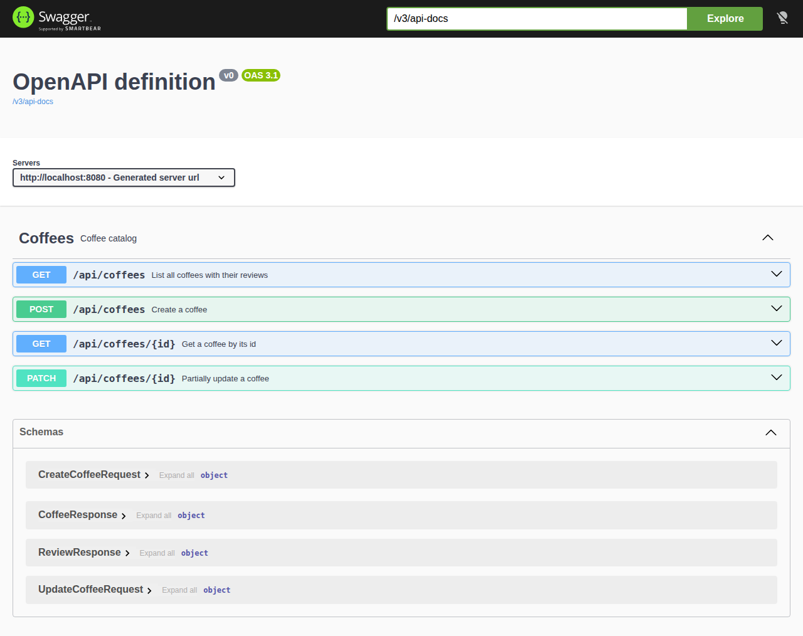
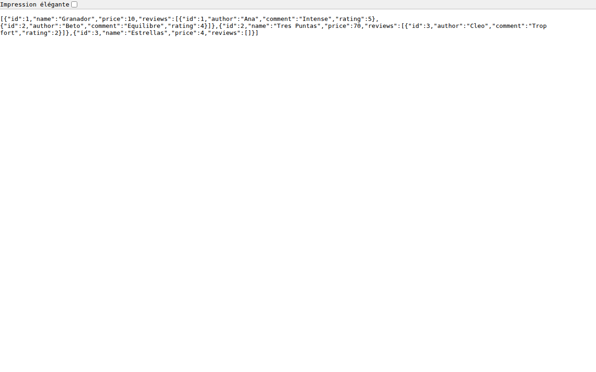
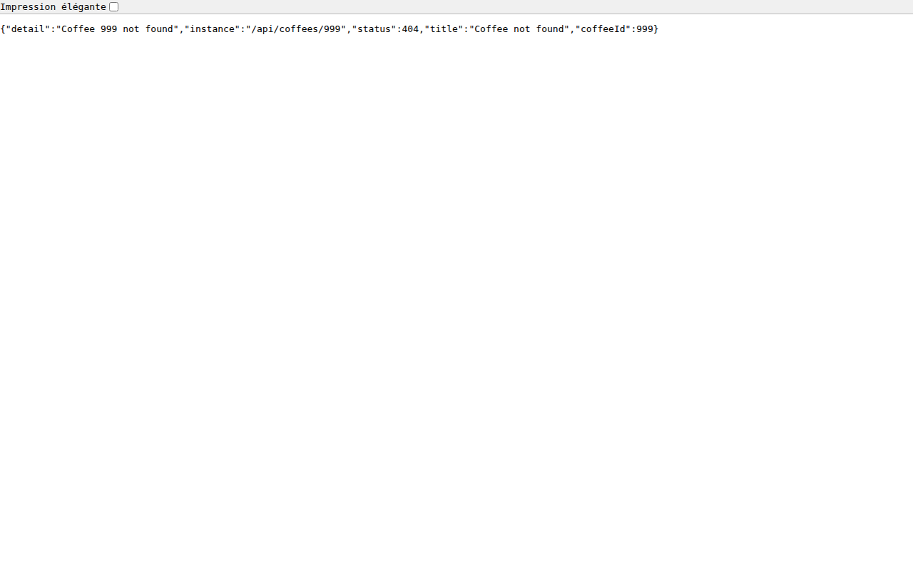
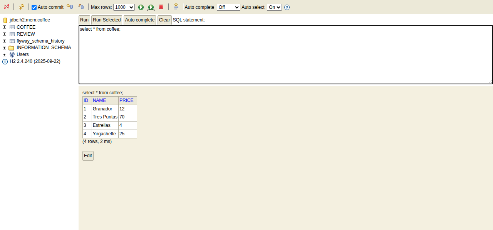
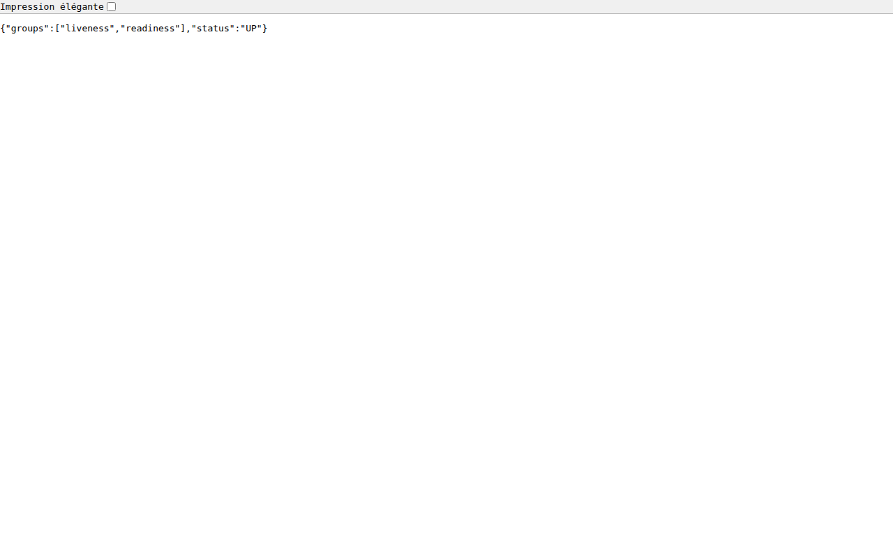

# coffee-hexa-simple

A small coffee catalog REST API (coffees and their reviews) built with hexagonal architecture: the domain and application layers are plain Java, and REST, JPA and transactions live in adapters.

## Run

```bash
./mvnw spring-boot:run
```

Swagger UI: http://localhost:8080/swagger-ui/index.html

## Screenshots

Swagger UI:



List of coffees:



Unknown coffee (404 problem details):



H2 console after a POST and a `PATCH {"price":12}`:



Health check:


